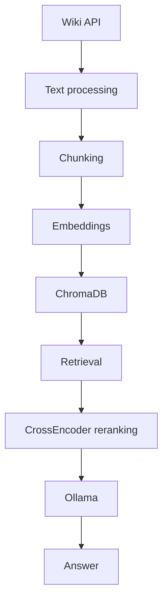
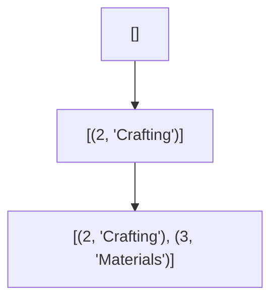
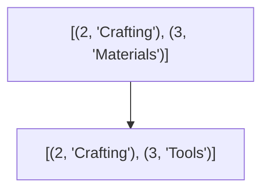
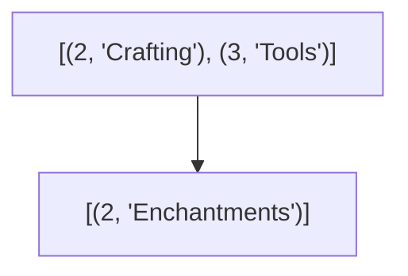

I didn't want to keep opening up my browser to look for minecraft information , so I made this! It's also good training to fill my current gap in RAG and LLM side of things.

You can checkout the project [here](https://github.com/HappyPotatoHead/mcwiki)

# Architecture and pipeline



## Wiki API, Text Processing, and Chunking

> This part is primarily picking pages from the wiki page and applying `re` to them, which I wouldn't get into detail for this project. BUT, what I would get into detail is how each page has their information extracted.

In the early stages of the application, I used `.md` files for simplicity sake. It looked like this:

> [!EXAMPLE]- Crafting.md
>
> ```md
> # Crafting
>
> ## Crafting Table
>
> A crafting table is crafted using four planks of any wood type.
>
> The four planks are placed in a 2x2 crafting grid. A crafting table provides a 3x3 crafting grid.
>
> ## Furnace
>
> A furnace is crafted using eight cobblestone, cobbled deepslate, or blackstone blocks.
>
> The crafting recipe uses every slot of the 3x3 crafting grid except the centre slot.
>
> A furnace can smelt ores, food, and various other items.
>
> ## Chest
>
> A chest is crafted using eight planks of any wood type.
>
> The recipe uses every slot of the 3x3 crafting grid except the centre slot.
>
> ## Torch
>
> A torch is crafted using one stick and one coal or charcoal.
>
> A torch produces light and can be placed on the floor or walls.
>
> ## Nether Portal
>
> A Nether portal is constructed using obsidian blocks.
>
> The smallest functional portal frame uses ten obsidian blocks when the four corner blocks are omitted.
>
> A flint and steel can be used to activate the portal by setting fire inside the frame.
>
> ## Anvil
>
> An anvil is crafted using three blocks of iron and four iron ingots.
>
> An anvil can be used to repair items, combine enchantments, and rename items.
>
> Using an anvil consumes experience levels and may eventually make an operation too expensive.
> ```

BUT, this isn't very scalable (I'm lazy), so once I made sure that this form of ingestion/fetching works, I decided to switch to using WikiAPI.

Within each page, there are two primary processes at work:

1. The splitting of sections and keeping track of sections and their subsections
2. Chunking the body texts
3. Packing of paragraphs

### The splitting of sections

A stack is used here to keep track of where we are in the hierarchy.

Assuming an article contains:

```md
== Crafting ==

blah blah

=== Materials ===

iron

=== Tools ===

pickaxe

== Enchantments ==

efficiency
```

As we walk through the wiki, the stack might look like:



But then we encounter Tools, which is also a level 3. So, we replace materials with tools



And the same thing happens when we encounter Enchantments, level 2. We remove Tools because that's a level lower than 2. Essentially, removing any subheadings along with the headings



### Chunking body texts

What is achieved here is breaking down the body of texts into chunks.

```py
chunks: list[str] # this is basically a collection of chunks
current: list[str] # what we use to iterate through the paragraph of texts
```

Imagine we have 3 paragraphs each with 700 characters. Assuming that the maximum chunk limit is 1400, the chunks will look like this,

```py
chunks = ["paragraph 1 paragraph 2", "paragraph 2 paragraph 3"]
```

Notice that paragraph 2 appears in both chunks. This is chunk overlap.

There might be instances where contexts cross chunks, so taking that into account, an overlap is implemented; A chunk can contain information that is only meaningful when read together with the text immediately before or after it.

The overlapping is implemented under the condition that the current chunk exceeds half of the max per chunk.

_So, why_ <span class = "tooltip"> _half?_ <span class = "tooltiptext"> because heuristic </span> </span>

The idea is to avoid spending overlap on chunks that are already short enough, while preserving context when a chunk is substantial enough that a boundary could split useful information; too low, and there will be a lot of overlapping in each chunk, eating away at your tokens and storage, redundant retrieval; too high, and there might be very little overlapping.

Whether 50% is the right threshold depends on the text and the chunking strategy. For now, it's a reasonable starting point, rather than a value I've empirically established as optimal.

So imagine,

```
Chunk 1:

paragraph A
paragraph B
paragraph C
```

and we need to start another chunk. Instead of:

```
Chunk 2:
paragraph D
paragraph E
```

we might get:

```
Chunk 2:
paragraph C
paragraph D
paragraph E
```

### Packing paragraphs

Yeah this is what it looks like

```json
{
    "id": "12345:7",
    "title": "Villager",
    "section": "Breeding > Mechanics",
    "content": "Villagers can breed when...",
    "embed_text": "Villager > Breeding > Mechanics\n\nVillagers can breed when...",
    "url": "https://minecraft.wiki/...",
    "pageid": "12345"
}
```

The separate embed_text is made for context for the subsequent embedding model

## Embedder

The model used here is `Qwen/Qwen3-Embedding-0.6B`. Since, it's a local application and it's in its early stages, I decided to go with a small, but effective model first. Also, the limited HuggingFace inference credits was a major obstacle. The major limitation

Otherwise, there's really not much to this stage of the application. It's primarily embedding the retrieved texts and query into vectors.

```py
# this is for document
return self._get_model().encode(
    texts,
    # because the texts might just be gigantic
    batch_size=batch_size,
    # normalisation of embedding is for better performance
    # also cosine similarity
    normalize_embeddings=True,
    show_progress_bar=len(texts) > batch_size,
)

# this is for queries
return self._get_model().encode(
    query_instructions + query,
    normalize_embeddings=True,
)
```

## Chromadb

> I was looking for vector databases to replace my approach of saving into memory, so I came across chromadb

There's really nothing much to this either; it's just standard chromadb implementation. It simplified my initial cosine similarity implementation.

It saved a lot of code, and add more to the things that I can implement.

```py
result = collection.query(
    query_embeddings=[query_embedding],
    n_results=top_n,
    # document is the text
    include=["documents", "metadatas", "distances"],
)
```

## Retrieving and Reranking

The model used here is `cross-encoder/ettin-reranker-400m-v1`. It's built on the ModernBERT backbone and it supports 7,999 tokens, meaning it's good for long-form documents, just like the minecraft wiki

Moving on to retrieval, basically the search function that the application calls. It is at this stage where the reranking is also applied. There are three primary functions here,

```py
def retrieve(
    self,
    query: str,
    top_n: int,
    embedder: Embedder,
    database: ChromaStore,
    query_instructions: str,
) -> list[Match]:
    query_embedding = embedder.embed_query(query, query_instructions)
    top_results = database.query(query_embedding, top_n)

    return [
        Match(
            id=str(result.get("id") or ""),
            title=str(result.get("title") or ""),
            section=str(result.get("section") or ""),
            url=str(result.get("url") or ""),
            content=str(result.get("embed_text") or ""),
            cosine=float(result.get("cosine") or 0.0),
        )
        for result in top_results
    ]
```

This function is focused around cosine similarity, hence the lack of `k`.

```py
def rerank(self, query: str, matches: list[Match]) -> list[Match]:
    if not matches:
        return []

    reranker = self._get_reranker()
    pairs = [(query, match.content) for match in matches]
    scores = reranker.predict(pairs)

    for match, score in zip(matches, scores):
        match.rerank_score = float(score)

    return sorted(
        matches,
        key=lambda match: (
            match.rerank_score if match.rerank_score is not None else float("-inf")
        ),
        reverse=True,
    )
```

and

```py
def search(
    self,
    query: str,
    k: int,
    top_n: int,
    rerank: bool,
    embedder: Embedder,
    database: ChromaStore,
    query_instructions: str,
) -> list[Match]:
    matches = self.retrieve(query, top_n, embedder, database, query_instructions)
    if rerank and matches:
        matches = self.rerank(query, matches)

    return matches[:k]
```

The `top_n` is implemented to cast a wide net; it's cheaper and lets us gather more information before narrowing it down with `k`. Now, there are other implementations of retrieval and whatnot, but cosine similarity + reranking seems to be the tried and true method for most application.

Of course, it is not perfect, but it gets you started.

## Answer Generation

The model of choice here is `llama3.1:8b`. Since the model is an older, small, local, lightweight model, the output of the model might not be as robust compared to other larger, more modern models, local or not. But, this is also helpful in another way, which is clarifying the output of the model. In larger, more moden models, the output, accurate or not, may be attributed to its much larger knowledge base, not the pulled wiki.

This is the prompt I used,

```py
def _generate_prompt(self, query: str, context: str) -> str:
    return f"""
    You are a Minecraft knowledge assistant.

    Answer the user's question using only the provided context.

    If the context does not contain enough information to answer the question,
    say that you do not have enough information.

    Context:
        {context}

    Question:
        {query}

    Answer:
        """
```

# Example Queries and Results

Putting it all together with a cli library, `typer`, I am able to call and use the application. Here are some examples,

> "How do I fly?"

```
Generating answer with llama3.1:8b
╭──────────── Answer ──────────────────╮
│ To fly, you can double-tap the "jump" key while playing  │
│ in Creative mode (or when the "May fly" privilege has    │
│ been given to the player) and it will be toggled on. You │
│ can also use the "/fly" command with no arguments to     │
│ toggle flying on or off.                                 │
╰───────────────────────────────────╯

Sources:
  [1] Flying > Controls  cosine=0.612  rerank=8.121
      https://minecraft.wiki/wiki/Flying
  [2] Commands/fly > (intro)  cosine=0.540  rerank=8.087
      https://minecraft.wiki/wiki/Commands/fly
  [3] Commands/fly > Syntax  cosine=0.619  rerank=8.005
      https://minecraft.wiki/wiki/Commands/fly
  [4] Creative > Gameplay > Flying  cosine=0.563  rerank=7.875
      https://minecraft.wiki/wiki/Creative
  [5] Commands/fly > Arguments  cosine=0.607  rerank=7.749
      https://minecraft.wiki/wiki/Commands/fly
```

> "How do I kill a mob?"

```
Generating answer with llama3.1:8b
╭──────────── Answer ──────────────────╮
│ You can use the `/kill` command to directly kill a       │
│ living target, compulsorily removing the entity from the │
│ game. This will prompt a death message, and players or   │
│ mobs killed this way will drop loot. Additionally, you   │
│ can also take advantage of mob infighting by damaging a  │
│ mob, causing it to retaliate against its attacker and    │
│ potentially leading to the distraction and weakening of  │
│ both combatants.                                         │
╰───────────────────────────────────╯

Sources:
  [1] Mob > Behavior  cosine=0.499  rerank=9.280
      https://minecraft.wiki/wiki/Mob
  [2] Commands/kill > Usage  cosine=0.534  rerank=8.992
      https://minecraft.wiki/wiki/Commands/kill
  [3] Commands/kill > (intro)  cosine=0.532  rerank=8.391
      https://minecraft.wiki/wiki/Commands/kill
  [4] Mob infighting > Overview  cosine=0.513  rerank=8.197
      https://minecraft.wiki/wiki/Mob_infighting
  [5] Mob > (intro)  cosine=0.602  rerank=7.762
      https://minecraft.wiki/wiki/Mob
```

> "How do I transport items automatically?"

```
╭──────────── Answer ──────────────────╮
│ You can use various devices and mechanisms to transport  │
│ items automatically, such as:                            │
│                                                          │
│ * Hoppers: key for item handling and sorting             │
│ * Item transportation: moves items                       │
│ * Minecart with hopper: collects, transports, and        │
│ distributes items over rails                             │
│ * Boat with chest: can transport both mobs and items,    │
│ and hoppers can be used to insert and extract items      │
│ * Bubble columns: created by placing magma blocks or     │
│ soul sand under water, which can transport mobs or items │
│ quickly vertically                                       │
│                                                          │
│ You can also use a Crafter (Automated crafting systems)  │
│ or Item sorting devices mentioned in the tutorials       │
│ section. Additionally, you can use Redstone components   │
│ like Minecart with chest to store and transport items    │
│ over rails.                                              │
│                                                          │
│ It's worth noting that you'll need to set up these       │
│ devices accordingly to make them work automatically. The │
│ provided context should give you a good starting point   │
│ for automating item transportation in Minecraft!         │
╰───────────────────────────────────╯

Sources:
  [1] Tutorials > Mechanisms > Various devices  cosine=0.523
rerank=8.562
      https://minecraft.wiki/wiki/Tutorials
  [2] Redstone components > Entity components > Minecart
with chest  cosine=0.461  rerank=8.018
      https://minecraft.wiki/wiki/Redstone_components
  [3] Redstone components > Entity components > Minecart
with hopper  cosine=0.451  rerank=7.991
      https://minecraft.wiki/wiki/Redstone_components
  [4] Redstone components > Entity components > Boat with
chest  cosine=0.478  rerank=7.912
      https://minecraft.wiki/wiki/Redstone_components
  [5] Water > Usage > Vertical transport  cosine=0.421
rerank=7.682
      https://minecraft.wiki/wiki/Water
```

> "How do I become spiderman?"

```
Generating answer with llama3.1:8b
╭──────────── Answer ──────────────────╮
│ I don't have enough information to answer that question. │
│ The context only provides information about spiders in   │
│ the game Minecraft and does not provide any guidance on  │
│ becoming a real-life superhero like Spider-Man.          │
╰───────────────────────────────────╯

Sources:
  [1] Spider > Spawning > Monster spawners  cosine=0.519
rerank=7.283
      https://minecraft.wiki/wiki/Spider
  [2] Spider > Spawning  cosine=0.442  rerank=7.263
      https://minecraft.wiki/wiki/Spider
  [3] Spider > Spawning > Trial spawners  cosine=0.494
rerank=6.605
      https://minecraft.wiki/wiki/Spider
  [4] Spider > Spawning > Spider jockeys  cosine=0.464
rerank=6.310
      https://minecraft.wiki/wiki/Spider
  [5] Spider > Spawning > Status effects  cosine=0.416
rerank=6.002
      https://minecraft.wiki/wiki/Spider
```

# Evaluation

> This requires more weeks of concentrated work
> The current evaluation is put together with duct tape, so not exactly the best content at the moment

# Limitations

While the application can retrieve relevant Minecraft Wiki content and generate answers locally, there are several limitations.

## Retrieval Quality

The application relies on embedding similarity to retrieve candidate chunks. However, semantic similarity does not necessarily mean that a chunk contains the information needed to answer a question. Relevant pages may also contain chunks that are unrelated to the query, while useful information may not make it into the initial candidate set at all.

CrossEncoder reranking helps refine the ordering of retrieved candidates, but it cannot recover relevant information that was never retrieved in the first place.

## Chunking Strategy

The current chunking strategy uses a configured maximum chunk size and conditional overlap to preserve context across chunk boundaries. However, a fixed chunk size may not suit every type of Wiki content. Some explanations can be understood within a short chunk, while others depend on surrounding paragraphs or longer sequences of instructions.

The overlap threshold is also heuristic rather than empirically optimised. Different chunk sizes and overlap strategies may produce different retrieval results.

## Evaluation Scope

The retrieval evaluation uses a benchmark of 100 queries with manually defined relevant page titles. Although metrics such as Hit@K, Recall@K and Mean Reciprocal Rank (MRR) provide useful insights into retrieval performance, the benchmark is limited to its selected questions and relevance labels.

Furthermore, retrieval metrics alone do not establish whether the generated answers are accurate, complete or grounded in the retrieved content. A separate evaluation of answer quality would be needed to assess these aspects.

## Local Language Model

The application uses a locally hosted language model to generate answers from retrieved content. Its responses may still contain inaccuracies, omit relevant details or introduce information that is not supported by the retrieved passages. Providing context through retrieval can help ground generation, but does not guarantee factual correctness.

# Future Improvements

Potential improvements include experimenting with chunk sizes and overlap thresholds, comparing alternative embedding models and rerankers, expanding the evaluation benchmark, and introducing answer-level evaluation to measure factual accuracy and grounding.

# Running the Project

The source code and detailed setup instructions are available on GitHub.

The application requires Python, the project's Python dependencies, and Ollama to run the local language model. The embedding and reranking models are managed through the project's model dependencies.

After completing the setup described in the README, the basic workflow is:

1. Ingest Wiki content into the vector database. `./mcwiki ingest`
2. Ask a question through the command-line interface. `./mcwiki ask "How do I make a Nether portal?"`
3. Inspect retrieval results to understand which Wiki passages were selected.

For the exact installation steps, available commands, and configuration requirements, refer to the repository README.
